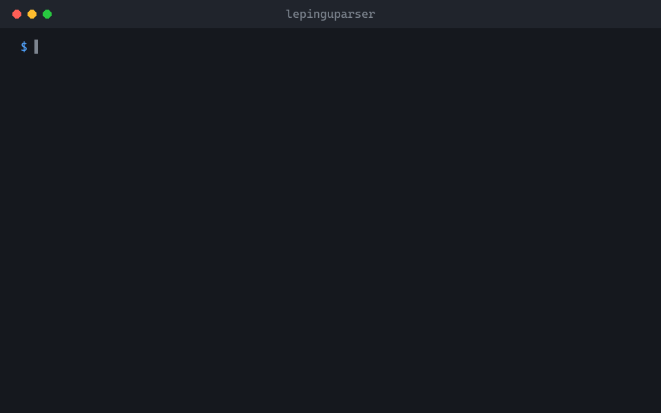

<p align="center">
  
</p>

<h1 align="center">lepinguparser</h1>

<p align="center">
  Leiab eesti lepingutest katkised viited, defineerimata terminid ja muud apsud: Wordi failides, PDF-ides ja DigiDoc konteinerites.<br>
  <sub>Käsurea tööriist ja MCP server juristidele ja neid abistavatele AI-assistentidele. Dokumendid ei lahku sinu arvutist.</sub>
</p>

<p align="center"><a href="https://github.com/Ker102/lepinguparser#readme">English</a> · <b>Eesti</b></p>

<p align="center">
  
</p>

<p align="center">
  <a href="https://github.com/Ker102/lepinguparser/releases/latest"><b>Laadi alla</b></a> &nbsp;·&nbsp; <a href="#alustamine">Alustamine</a> &nbsp;·&nbsp; <a href="https://github.com/Ker102/lepinguparser/blob/main/docs/juhend.md">Täielik juhend</a>
</p>

<p align="center">
  <sub>Töötab koos</sub><br>
  &nbsp;Claude Code &nbsp;·&nbsp; <picture><source media="(prefers-color-scheme: dark)" srcset="https://raw.githubusercontent.com/Ker102/lepinguparser/assets/brands/modelcontextprotocol-dark.svg"></picture>&nbsp;MCP &nbsp;·&nbsp; &nbsp;Go
</p>

## Mida see teeb

Anna sellele leping ja see loeb struktuuri nagu hoolikas jurist: punktide numbrid, defineeritud terminid ja kõik viited ühest punktist teise. See ütleb, mis on katki, et sina või su AI-assistent saaks selle enne allkirjastamist parandada.

- Leiab viited olematutele punktidele, defineerimata terminid ja definitsioonid, mida kuskil ei kasutata.
- Saab eesti keelest aru: teab, et „Lepingu“ ja „Lepingus“ on sama defineeritud termin mis „Leping“.
- Avab .docx-, PDF- ja .asice/.bdoc-failid otse, midagi lahti pakkimata ega üles laadimata.

> [!NOTE]
> Tööriist näitab, mis tundub vale; see ei ole õigusabi. Tühi tulemus ei tõenda, et lepingus vigu pole, ja PDF loetakse lehe paigutusest, seega kontrolli olulisi kohti originaalist.

## Alustamine

1. Laadi oma arvuti jaoks programm alla <a href="https://github.com/Ker102/lepinguparser/releases/latest">viimasest väljalaskest</a> ja paki lahti. (Kui Go on olemas, sobib ka <code>go install github.com/Ker102/lepinguparser/cmd/lepinguparser@latest</code>.)
2. Ühenda see Claude Code'iga: <code>claude mcp add lepinguparser -- /tee/lepinguparser mcp</code>
3. Küsi tavaliste sõnadega, näiteks: <i>„Kontrolli leping.pdf-is katkiseid viiteid ja defineerimata termineid.“</i>
4. Või käivita see ise terminalis:

```bash
lepinguparser kontroll -t leping.pdf
```

## Mida on vaja

- Windows, macOS või Linux. Programm on üks fail, muud pole vaja paigaldada.
- Claude Code, Claude Desktop või mõni muu MCP-d toetav assistent, kui tahad, et AI seda sinu eest kasutaks.
- Skannitud PDF-id lase enne läbi OCR-i, sest tööriist vajab päris teksti, mitte pilti tekstist.

## Mis on sees

- [`cmd/lepinguparser/`](https://github.com/Ker102/lepinguparser/blob/main/cmd/lepinguparser/) · Programm: käsurida ja MCP server.
- [`internal/`](https://github.com/Ker102/lepinguparser/blob/main/internal/) · Wordi, PDF-i ja allkirjakonteinerite lugejad ning lepingu kontrollid.
- [`skills/lepinguparser/SKILL.md`](https://github.com/Ker102/lepinguparser/blob/main/skills/lepinguparser/SKILL.md) · Ütleb AI-agendile, millal ja kuidas tööriista kasutada.
- [`docs/juhend.md`](https://github.com/Ker102/lepinguparser/blob/main/docs/juhend.md) · Täielik juhend: kõik käsud, vormingud ja piirangud.

<sub>Eelvaate pildid on harus <a href="https://github.com/Ker102/lepinguparser/tree/assets"><code>assets</code></a> ja tõlked harus <a href="https://github.com/Ker102/lepinguparser/tree/translations"><code>translations</code></a>, nii et <code>main</code> sisaldab ainult tööriista.</sub>

## Sõsarprojekt

<a href="https://github.com/Ker102/oigusallikad"></a>
**[oigusallikad](https://github.com/Ker102/oigusallikad)**<br>
Toob Eesti seaduse sätte, kohtulahendi punkti või ELi akti artikli otse ametlikust allikast, et saaksid kontrollida, millele leping viitab.
<br clear="left">

---

<sub>Apache 2.0 koos Commons Clause'iga: kasutamine vaba, müük keelatud · <a href="https://github.com/Ker102">Ker102</a></sub>
