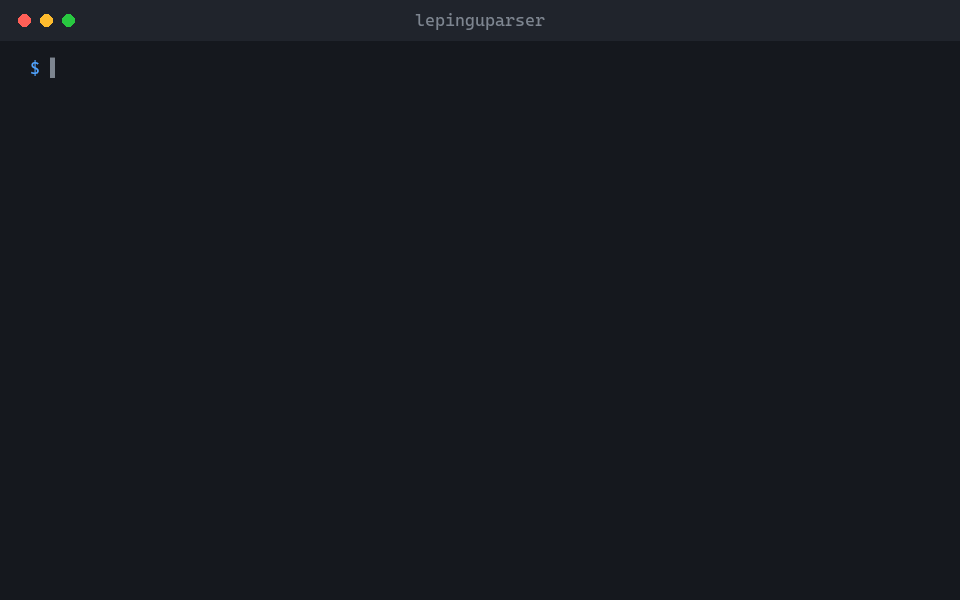

<p align="center">
  
</p>

<h1 align="center">lepinguparser</h1>

<p align="center">
  Finds broken clause references, undefined terms and other slips in Estonian contracts: in Word files, PDFs and signed DigiDoc containers.<br>
  <sub>A command-line tool and MCP server for lawyers and the AI assistants that help them. Your documents never leave your computer.</sub>
</p>

<p align="center"><b>English</b> · <a href="https://github.com/Ker102/lepinguparser/blob/translations/README.et.md">Eesti</a></p>

<p align="center">
  
</p>

<p align="center">
  <a href="https://github.com/Ker102/lepinguparser/releases/latest"><b>Download</b></a> &nbsp;·&nbsp; <a href="#get-started">Get started</a> &nbsp;·&nbsp; <a href="docs/juhend.md">Full guide (Estonian)</a>
</p>

<p align="center">
  <sub>Works with</sub><br>
  &nbsp;Claude Code &nbsp;·&nbsp; <picture><source media="(prefers-color-scheme: dark)" srcset="https://raw.githubusercontent.com/Ker102/lepinguparser/assets/brands/modelcontextprotocol-dark.svg"></picture>&nbsp;MCP &nbsp;·&nbsp; &nbsp;Go
</p>

## What it does

Give it a contract and it reads the structure the way a careful lawyer would: clause numbers, defined terms and every reference from one clause to another. It tells you what is broken, so you or your AI assistant can fix it before anyone signs.

- Catches references to clauses that don't exist, terms that are never defined and definitions nobody uses.
- Understands Estonian: it knows that „Lepingu“ and „Lepingus“ are the same defined term as „Leping“.
- Opens .docx, PDF and .asice/.bdoc signature containers as they are, without unpacking or uploading anything.

> [!NOTE]
> It points out what looks wrong; it is not legal advice. An empty result does not prove a contract is flawless, and PDFs are read from the page layout, so check important places against the original.

## Get started

1. Download the program for your computer from the <a href="https://github.com/Ker102/lepinguparser/releases/latest">latest release</a> and unzip it. (With Go installed you can also run <code>go install github.com/Ker102/lepinguparser/cmd/lepinguparser@latest</code>.)
2. Connect it to Claude Code: <code>claude mcp add lepinguparser -- /path/to/lepinguparser mcp</code>
3. Ask in plain words, for example: <i>“Check leping.pdf for broken references and undefined terms.”</i>
4. Or run it yourself in a terminal:

```bash
lepinguparser kontroll -t leping.pdf
```

## What you need

- Windows, macOS or Linux. The program is a single file with nothing else to install.
- Claude Code, Claude Desktop or another MCP-capable assistant, if you want AI to use it for you.
- For scanned PDFs: run them through OCR first, because the tool needs real text, not pictures of text.

## What's inside

- [`cmd/lepinguparser/`](cmd/lepinguparser/) · The program: command line and MCP server.
- [`internal/`](internal/) · Readers for Word, PDF and signature containers, and the contract checks.
- [`skills/lepinguparser/SKILL.md`](skills/lepinguparser/SKILL.md) · Tells an AI agent when and how to use the tool.
- [`docs/juhend.md`](docs/juhend.md) · The full guide in Estonian: every command, format and limit.

<sub>Preview media lives on the <a href="https://github.com/Ker102/lepinguparser/tree/assets"><code>assets</code></a> branch and translations on <a href="https://github.com/Ker102/lepinguparser/tree/translations"><code>translations</code></a>, so <code>main</code> holds only the tool.</sub>

## Sister project

<a href="https://github.com/Ker102/oigusallikad"></a>
**[oigusallikad](https://github.com/Ker102/oigusallikad)**<br>
Fetches the exact section of an Estonian law, a court ruling or an EU act straight from the official source, so you can check what a contract refers to.
<br clear="left">

---

<sub>Apache 2.0 with Commons Clause: free to use, not to sell · <a href="https://github.com/Ker102">Ker102</a></sub>
